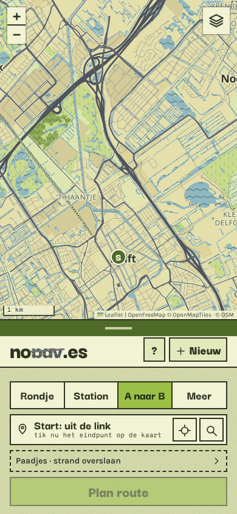
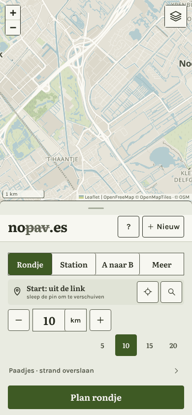
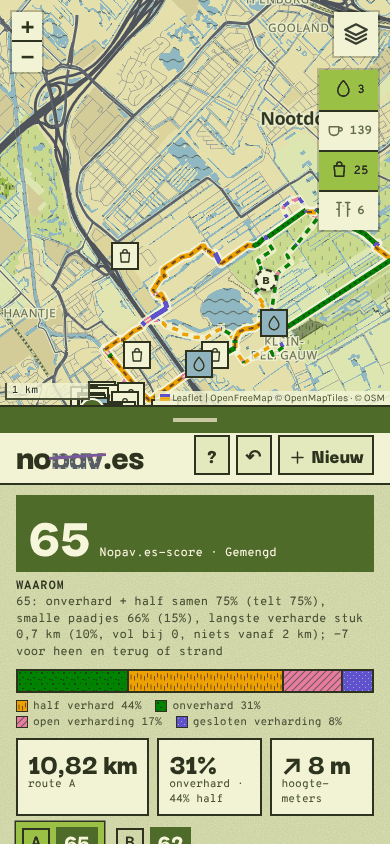
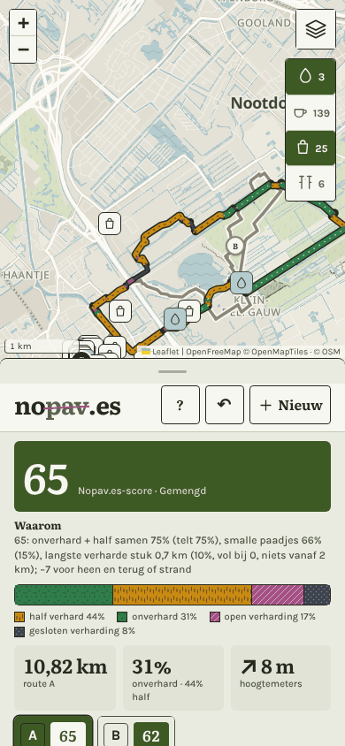
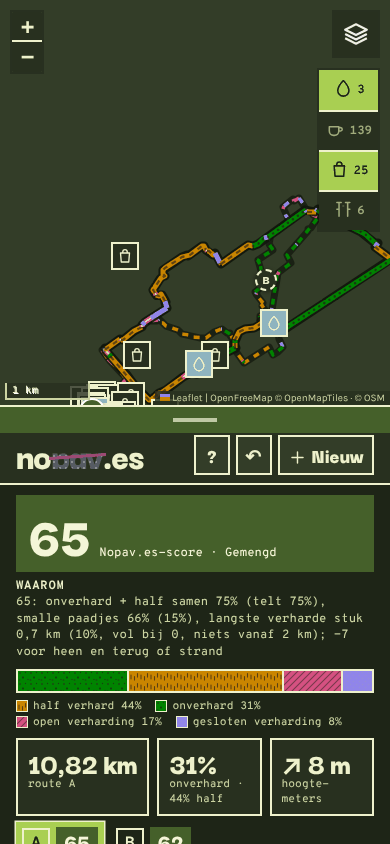
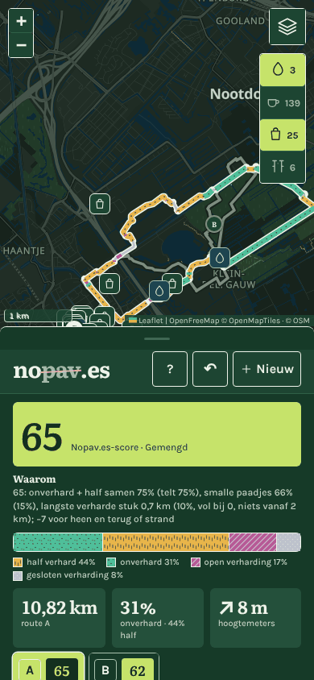
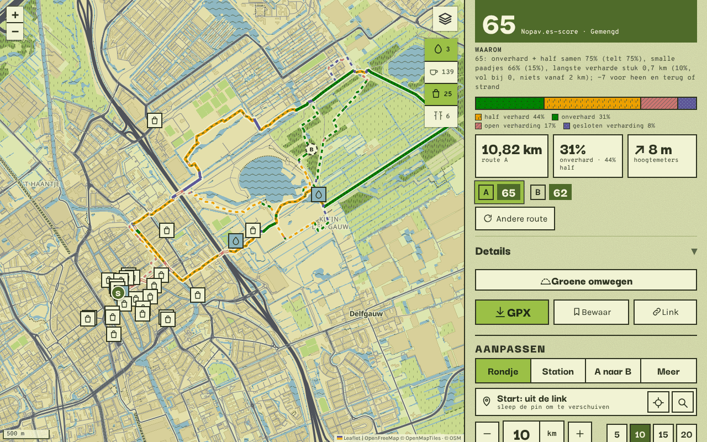
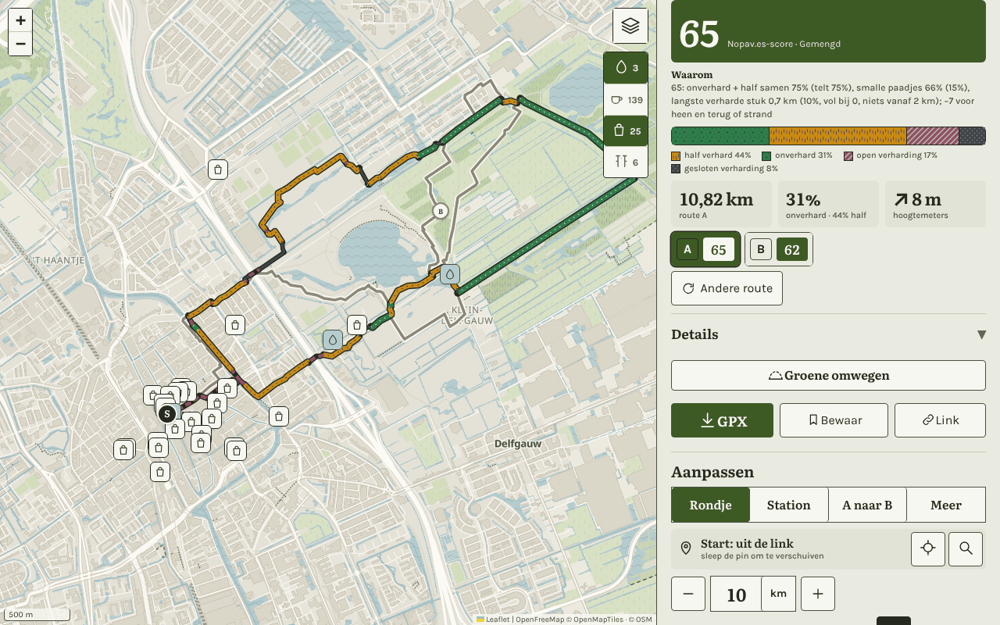

# Nopav.es: nieuwe look & feel

## Samenvatting

Nopav.es heeft een nieuwe huisstijl: **Veldboek**. Een veldgids voor onverharde paden: aardse kleuren
(veen, mos, stro, heide) op salie-grijs papier, een boekletter voor koppen en cijfers, fijne lijnen, en een
rustige kaart waarop de route het meest opvallende is. In het donker het diepe groen van het bos
(**Bosgroen**). Gekozen door Oscar uit 30 schetsen (2026-11-21).

**De routelijn vertelt nu zelf de ondergrond**: hoe zachter de grond, hoe dikker de lijn (onverhard dik,
asfalt dun, klinkers gestreept, onbekend gestippeld), met een rand die tegen elk kaartvlak ruim 3:1 haalt.
Alternatieven zijn grijs. Gemeten: tekst overal ≥ 4,5:1, de vijf ondergronden blijven uit elkaar bij
kleurenblindheid, axe vindt geen overtredingen, alle knoppen ≥ 44 px.

| | Voor (Korrel) | Na (Veldboek) |
|---|---|---|
| Plankaart |  |  |
| Resultaat |  |  |
| Donker |  |  |
| Desktop |  |  |

Alle schermen en toestanden: [ontwerp/huidig/](ontwerp/huidig/) en [ontwerp/na/](ontwerp/na/). Op je eigen
telefoon testen: [ontwerp/telefoontest.md](ontwerp/telefoontest.md).

---

Voortgangsbestand van de ontwerpopdracht (2026-11-20). Begint een sessie met "ga verder": lees dit
bestand en ga verder bij de eerste stap die niet `klaar` is. Werk op de sessiebranch; PR's heten
`feat: ontwerp …`.

## Status

| Stap | Status | Waar |
|---|---|---|
| 0 Huidige stand vastleggen | klaar | [ontwerp/huidig.md](ontwerp/huidig.md), beelden in `ontwerp/huidig/` |
| 1 Ontwerptokens | klaar (pixelgelijk, Playwright telefoon en desktop groen) | `public/tokens.css`, `public/kaarttokens.js` |
| 2 Drie richtingen achter `?ontwerp=a\|b\|c` | gebouwd en gecontroleerd; PR en samenvoegen volgen | `public/ontwerp/`, [ontwerp/richtingen.md](ontwerp/richtingen.md) |
| Schetsen | klaar: 30 schetsen van het eerste scherm (op Oscars verzoek, in plaats van drie uitgewerkte richtingen) | [ontwerp/schetsen/](ontwerp/schetsen/) |
| Keuze | klaar: Oscar koos **4 Veldboek** met het donkere paneel van **12 Bosgroen** als donker thema (2026-11-21); zoekbalk boven: nee (zie hieronder) | |
| 3 Uitrollen | klaar: Veldboek standaard in alle schermen, manifest en pictogram nieuw, review-lus, CLAUDE.md bijgewerkt | `public/tokens.css`, `public/kaarttokens.js`, `public/kaartstijl.js`, `ontwerp/na/` |
| 4 Beter testen | klaar: visuele regressie, wandeling, metingen, telefoontest | `tests/visueel/`, `tests/test_wandeling.mjs`, [ontwerp/metingen.md](ontwerp/metingen.md), [ontwerp/telefoontest.md](ontwerp/telefoontest.md) |
| Release v1.3.0 | klaar (2026-11-21): PR [#25](https://github.com/oscardillewaard-ai/nopaves/pull/25) samengevoegd na groene `test`, [release v1.3.0](https://github.com/oscardillewaard-ai/nopaves/releases/tag/v1.3.0) (v1.2.0 bestond al) | |

## Hulpmiddelen

- `tools/ontwerp/schermen.mjs <map> [query] [alleen=a,b]`: alle schermen en toestanden, telefoon
  390 × 844 en desktop 1280 × 800, licht en donker (`TOESTEL=`, `THEMA=` om te beperken). Vraagt
  `python3 tools/serve.py` en netwerk naar `tiles.openfreemap.org` (op 2026-11-20 toegevoegd aan de
  omgeving `nopaves`, samen met `brouter.de` en `overpass-api.de` die de Playwright-tests nodig hebben).
- `tools/ontwerp/kleurcheck.mjs [richting]`: tekstcontrast (≥ 4,5), routelijnen tegen de kaart (≥ 3),
  en het kleinste verschil (CIEDE2000) tussen de vijf klassen bij deuteranopie, protanopie en
  tritanopie. Paletten in `tools/ontwerp/paletten.mjs`.
- Pixelvergelijking voor en na: zie stap 1 hieronder.

## Skills: wanneer en wat ze opleverden

| Wanneer | Skill | Opbrengst |
|---|---|---|
| Stap 0 | `ui-review` | 15 punten, waarvan 6 "moet beter"; belangrijkste: de route haalt geen 3:1 tegen de kaart (gemeten), de kaart is te druk, alternatief lijkt op de gekozen route. Zie huidig.md |
| Stap 0 | `ui-compare` | UXKIN niet bereikbaar (proxy), dus vergelijking met bekende conventies van Komoot, Strava, AllTrails, Google en Apple Maps: gedempte kaart, route met rand, alternatieven neutraal met label |
| Stap 2 | `frontend-design` | Plan van drie richtingen; getoetst aan de valkuilen (crème + serif + terracotta, zuur groen op zwart, overal hoofdletters en mono-labels). Gevolg: geen crème in C (salie-grijs), geen mono en geen hoofdletterlabels in alle drie, in B alleen het woordteken in hoofdletters |
| Stap 2 | `no-ui-slop` | Getoetst: één accent per richting (A geen, B kobalt met geel alleen voor de score, C mos met heide alleen voor tekenen en focus), geen verlopen of glas, alle toestanden blijven van het bestaande ontwerp |
| Stap 2 | `ui-review` | Per richting sterk en zwak, in richtingen.md; bug gevonden in B (lege kaart na sheetwissel), opgelost |
| Stap 2 | `accessibility-review` | axe-core: 0 overtredingen in alle richtingen; aanraakdoelen van 14 tot 26 te klein naar 1 (greep, haalt 24 px); focusring per richting |
| Stap 2 | `ux-copy` | Niet nodig: geen nieuwe teksten |
| Stap 2 | `ui-compare` | Niet opnieuw gedraaid: de vergelijking van stap 0 bepaalde de routetaal (rand, neutraal alternatief) |

## Stap 1: tokens (klaar in code)

- `public/tokens.css`: letters, vorm (hoeken, randen, schaduwen), afstanden, beweging en alle kleuren,
  licht en donker. `styles.css` bevat geen losse kleur of letter meer (gecontroleerd met grep op hex,
  `rgb(` en lettertypenamen).
- `public/kaarttokens.js`: `KAART` (alle kleuren en keuzes van de MapLibre-stijl) en `ROUTE`
  (rand, lijn, korrel per klasse, alternatieven, twijfel, tekening, slepen, omwegen, afspeelstip,
  luchtfoto). `korrelkaart.js` en `app.js` lezen alleen hieruit.
- Opgeruimd: dode CSS van de oude intro-tekening, overschreven regels met losse kleuren.
- **Pixelgelijk**: 22 schermen (telefoon licht, desktop donker) voor en na vergeleken; geen pixel
  wijkt meer dan 40/255 af (alleen ruis in de kaarttegels).
- Kleine bewuste afwijking: het kaartmenu (lang drukken) was rond met schaduw, buiten Korrel om; nu
  volgt het de tokens (vierkant, geen schaduw).
- Unit 51/51, lint schoon. Playwright: zie PR.

## Stap 2: plan van de drie richtingen

Gemeenschappelijke routetaal (uit de review): **hoe zachter de grond, hoe dikker de lijn**. Onverhard
dik en effen, half verhard dik met korrel, open verharding middel en gestreept, asfalt dun en effen,
onbekend dun en gestippeld. Elke lijn heeft een rand die tegen elk kaartvlak ≥ 3:1 haalt.
Alternatieven: één neutrale kleur, dunner, met een letter. Zo hangt de klasse niet aan kleur alleen.

| | A Stil | B Startnummer | C Veldboek |
|---|---|---|---|
| Idee | kaart eerst, ingetogen; de interface is grijs, alleen de grond heeft kleur | sportief en uitgesproken; een startnummer: wit vlak, hoge cijfers, kobalt en geel | natuurlijk en verfijnd; volwassen opvolger van Korrel, een veldgids |
| Letters | Atkinson Hyperlegible Next (één familie, leesbaar in de zon), 34 kB | Archivo met breedte-as: smal en zwaar voor cijfers en koppen, normaal voor tekst, 51 kB | Literata (boekletter) voor koppen en cijfers, Karla voor tekst, 76 kB |
| Vorm | zachte hoeken (10/16 px), geen randen op leesvlakken, lichte schaduw alleen op wat zweeft | 6 px hoeken, pillen, volle vlakken in plaats van randen | 4 px hoeken, fijne lijn van 1,5 px, geen schaduw, korrel in legenda en strook |
| Kaart | bijna kleurloos, wegen wit met grijze rand, paden zacht gestippeld | koel en scherp, wegen wit, meer contrast | aards: stro, mos, heide, zand; paden in veenbruin; korrel heel licht |
| Route | donkere rand (licht) / lichte rand (donker), helder palet | dikste lijnen, marineblauwe rand | aards palet, veenrand, korrel op de lijn |

Code van stap 2 staat in `public/ontwerp/a.css|b.css|c.css` (component- en tokenwaarden
per richting, alleen geladen bij `?ontwerp=`), `public/kaarttokens.js` (KAART/ROUTE per richting) en
`tools/ontwerp/paletten.mjs` (voor de controle).

## Keuze en wat eruit volgde (2026-11-21)

- **Gekozen**: schets 4 Veldboek (licht) met schets 12 Bosgroen als donker thema. Advies en afweging: niet te
  veel Komoot (wit, rond, felgroen), wel groen; Veldboek houdt de identiteit van Korrel maar is rustiger.
- **Zoekbalk boven (schets 27)**: niet doen. Zoeken is niet de hoofdtaak (meestal locatie of tikken), past
  slecht bij A naar B (twee plekken), kost kaart bovenin en is een functionele verandering.
- **Versie**: v1.3.0, omdat v1.2.0 al bestond.
- **Weggehaald** (vastgelegd in docs/branches-archief.md): Korrel (Darker Grotesque, Overpass Mono,
  korrelkaart.js, nu kaartstijl.js), de richtingen A/B/C en `?ontwerp=`, Atkinson en Archivo.
- **Lettertypen**: Literata (52 kB) en Karla (24 kB) = 76 kB; was 70 kB (Darker Grotesque, Karla, Overpass Mono).

## Stap 3: uitrollen (2026-11-21)

Skills en wat ze opleverden:

| Skill | Opbrengst |
|---|---|
| `ui-review` (ronde 1, alle 60 schermen) | golfjes op het water terug; kleine knoppen in de boekletter te zwaar; twee keuzekleuren (groen segment, zwarte snelkeuze); ondertitel in Korrel-hoofdletters; felgroene natuurgrenzen in het donker; water en land te dicht bij elkaar in het donker |
| `ui-polish` | alle zes opgelost (water effen, kleine knoppen in Karla, één keuzekleur, ondertitel gewoon, natuurgrenzen gedempt, water dieper) en opnieuw bekeken: geen punten met hoge prioriteit meer |
| `accessibility-review` | axe: 0 overtredingen (licht en donker); twee knoppen nog 36 à 40 px door een oudere regel: opgelost; kleurcheck van de gekozen combinatie: alles ✓ (krapste tekst 4,54:1) |
| `ux-copy` | weinig nieuwe tekst: laagnaam "Kaart" (was "Korrel"), CHANGELOG en telefoontest in gewone taal |
| `/code-review` | 8 punten, alle verwerkt: service worker noemde verwijderde lettertypen (installeerde niet), tekening en omwegen kregen bij een themawissel de oude kleuren, dunne stukken (asfalt) slecht te raken (nu een onzichtbare tikzone van 18 px), visuele test in CI mogelijk vals rood (voorlopig niet-blokkerend), omwegen in dezelfde kleur als onverhard (nu eigen olijfgroen), losse kleuren op de luchtfoto, thema zonder opslag |

## Stap 4: beter testen (2026-11-21)

- **Visuele regressie** (`npm run test:visueel`, `tests/visueel/`): plankaart, resultaat, voorkeuren en uitleg,
  telefoon en desktop, licht en donker (16 beelden). Kaarttegels, kaartletters en PDOK komen uit een opname
  (`bronnen.zip`), dus stabiel. Twee keer gedraaid: 16/16 gelijk. In CI voorlopig niet-blokkerend, omdat de
  basisbeelden in de cloudomgeving gemaakt zijn; als CI rood geeft op letterweergave, de basisbeelden één keer
  uit CI overnemen (bijlage `schermafbeeldingen`).
- **Wandeling** (`npm run test:wandeling`): rondje vanaf je locatie, station, A naar B, Meijendel, bewaren en
  terugvinden, alles via de knoppen, met een schermafbeelding per reis.
- **Metingen**: niet trager ([ontwerp/metingen.md](ontwerp/metingen.md)).
- **Telefoontest** voor Oscar: [ontwerp/telefoontest.md](ontwerp/telefoontest.md).

## Vervolgpunten (buiten deze opdracht)

- De laag winkels staat standaard aan en stapelt pictogrammen rond de start (gedrag, niet stijl).
- Een start op zee geeft pas laat een foutmelding.
- Na het plannen van een station zoomt de kaart op alle routes, waardoor het grijze alternatief veel ruimte krijgt.
- Zoekbalk bovenin (schets 27): bewust niet gedaan; kan als proef met echte gebruikers.

## Afgerond (2026-11-21)

De opdracht is af. PR #25 is samengevoegd (`af7e2e7`) nadat alle CI-stappen groen waren, óók de wandeling en
de visuele regressie (die waren voorlopig niet-blokkerend, maar slaagden in CI met de basisbeelden uit de
cloudomgeving). Release: https://github.com/oscardillewaard-ai/nopaves/releases/tag/v1.3.0.

### Voor Oscar

1. Doe de [telefoontest](ontwerp/telefoontest.md) (5 minuten).
2. Optioneel: maak de stappen "Wandeling" en "Visuele regressie" in `.github/workflows/test.yml` blokkerend
   (haal `continue-on-error: true` weg). In CI slaagden ze bij de eerste run.
3. Vervolgpunten als issue: de winkellaag die standaard aanstaat, de late foutmelding op zee, en de zoom na
   een stationsrit (zie hierboven).
