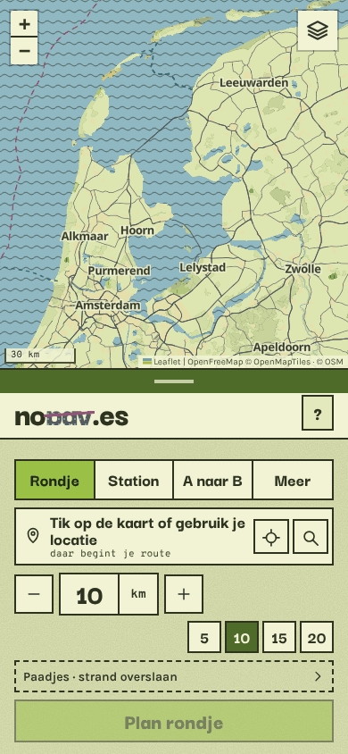
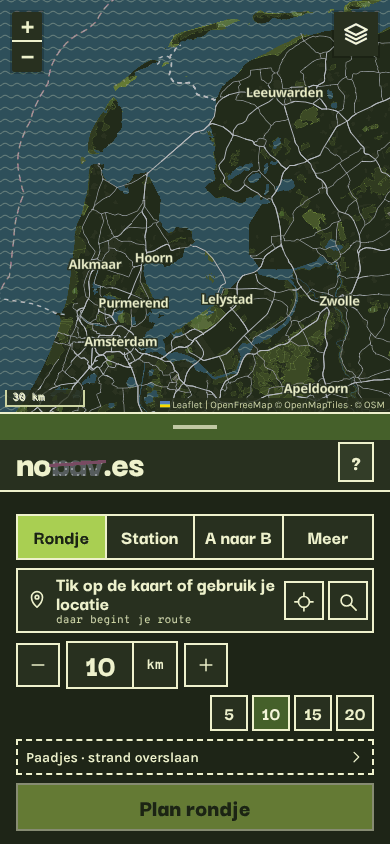
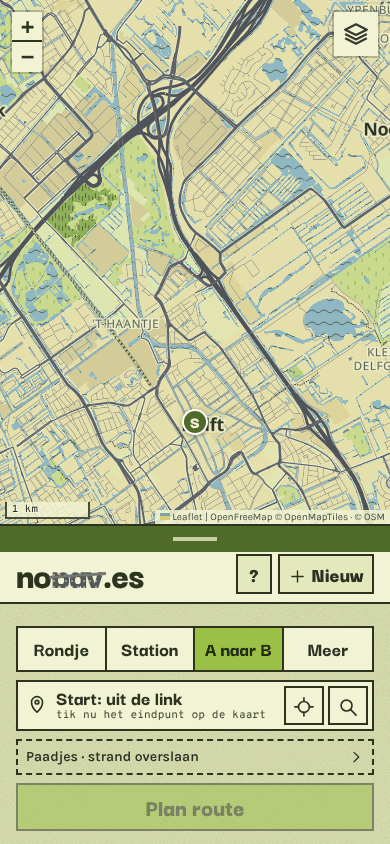
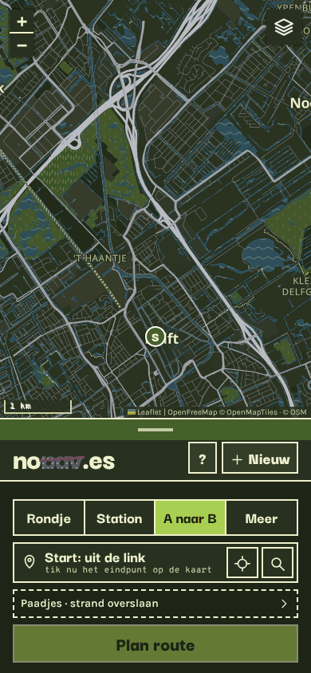
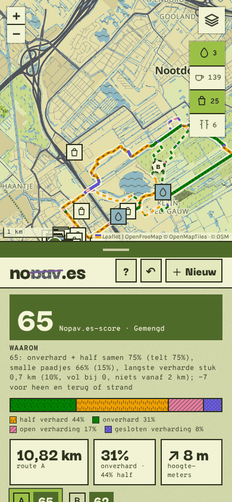
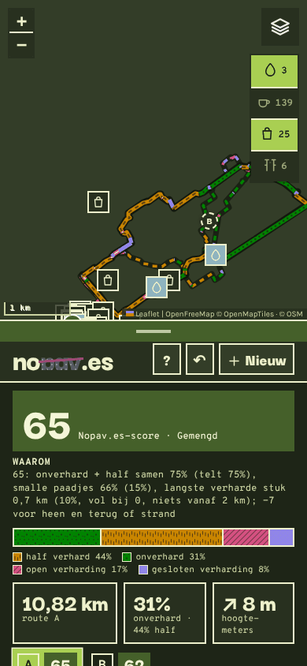
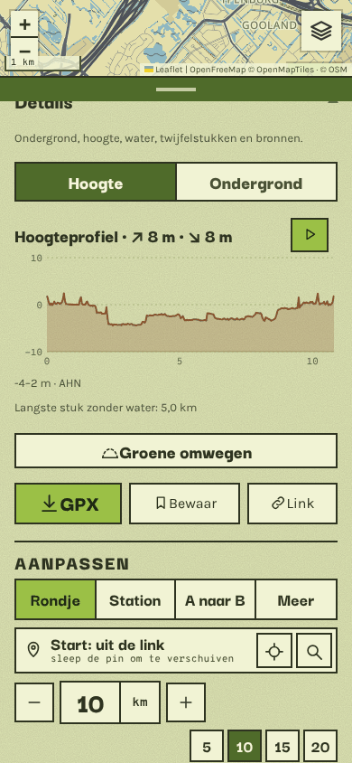
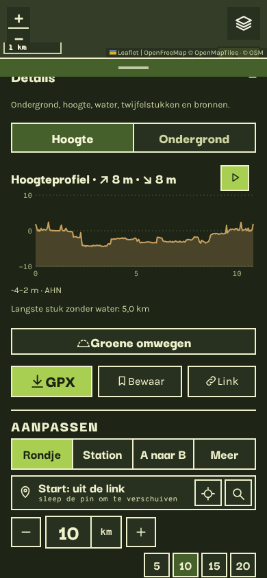
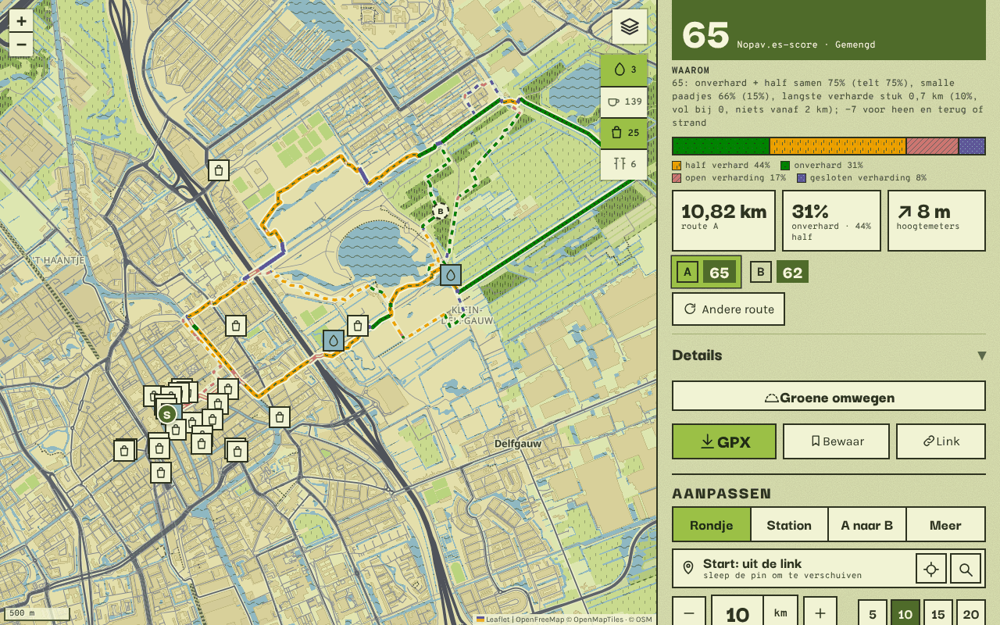

# Stap 0: de huidige stand (Korrel, v1.2.0-voor)

Vastgelegd op 2026-11-20 met `tools/ontwerp/schermen.mjs` (telefoon 390 × 844 en desktop 1280 × 800,
licht en donker) en `tools/ontwerp/kleurcheck.mjs` (contrast en kleurenblindheid). Alle beelden staan in
[huidig/](huidig/), met de naam `<toestand>_<toestel>_<thema>.png`.

Toestanden: `leeg` (nieuwe gebruiker), `plankaart` (start gezet), `meer` (Meer-soorten), `voorkeuren`,
`laden`, `resultaat-piek`, `resultaat-half`, `resultaat-vol`, `details`, `popup` (tik op de route),
`bewaar` (melding na bewaren), `mijnroutes`, `uitleg`, `gebruik` (Mijn gebruik), `fout` (rondje op zee).

| | Licht | Donker |
|---|---|---|
| Lege kaart |  |  |
| Plankaart |  |  |
| Resultaat, half |  |  |
| Details |  |  |

Desktop: 

## Waar het voor is

- **Doel**: een hardlooproute plannen over zo veel mogelijk onverhard, en zien hoe onverhard hij is.
- **Wie**: trailrunners en hardlopers in Nederland, vaak op de telefoon, vaak buiten.
- **Het ene dat moet lukken**: start kiezen, plannen, op de kaart in één oogopslag zien waar het zand
  en gras zit, en de GPX meenemen.

## ui-review (skill `ui-review`, 2026-11-20)

Bekeken op de beelden hierboven, niet alleen in de code. UXKIN was niet bereikbaar (proxy), dus zonder
voorbeelden uit echte apps; de vergelijking hieronder steunt op bekende conventies.

### Wat sterk is (behouden)

1. **Het plankaart-patroon.** Segment Rondje · Station · A naar B · Meer, één startregel, een
   afstandsstepper met snelkeuzes en één hoofdknop. Compact, alles binnen duimbereik, en het volgt
   het sheetpatroon dat mensen kennen uit kaart-apps.
2. **De ondergrond als kern van het merk.** Vijf klassen, en het idee dat de klasse niet alleen aan
   kleur hangt maar ook aan een patroon (korrel). Dat is het eigen karakter van Nopav.es en goed
   voor kleurenblinden. Het idee blijft; de uitvoering kan beter (zie 1 en 2 hieronder).
3. **De piekbalk**: score, soort, afstand en GPX in één regel. Precies wat je op de telefoon wilt zien
   terwijl de kaart groot blijft.
4. **Het grote scorecijfer** en het **hoogteprofiel** (één lijn, rustige assen).
5. **Geen standaard-AI-look.** Geen verlopen, geen glas, geen emoji, een eigen woordteken. Darker
   Grotesque in de koppen heeft karakter.
6. **Een eigen vectorkaart** (MapLibre op OpenFreeMap). De infrastructuur om de kaartstijl helemaal
   zelf te bepalen ligt er al.
7. Aanraakdoelen zijn bijna overal 44 px of groter; thema licht/donker werkt overal.

### Moet beter (hindert de hoofdtaak of de toegankelijkheid)

1. **De route valt weg tegen de kaart.** Gemeten (`kleurcheck.mjs`): geen enkele klassekleur haalt 3:1
   tegen de kaartvlakken (onverhard 2,0, half verhard 1,0, open verharding 1,1, gesloten 2,3,
   onbekend 1,4). De lichte rand om de route (#F6F7DD) heeft 1,16:1 tegen de lichte kaart, dus hij
   helpt niet. Oranje "half verhard" op een gele kaart is vrijwel onzichtbaar. *Oplossing*: een gedempte
   kaart en een rand om de route die tegen elk kaartvlak minstens 3:1 haalt.
2. **De kaart is zelf te druk en te verzadigd.** Geel-olijf als grondkleur, elk landgebruik een eigen
   tint, patronen op water (golfjes), gras, bos en heide, en een donkergrijs, zwaar wegennet. Alles
   vraagt aandacht, dus niets springt eruit. *Oplossing*: grond, bebouwing en landbouw bijna kleurloos;
   alleen bos, water en zand een rustige tint; wegen licht met een fijne rand; patronen weg uit de
   kaart (de korrel hoort bij de route, niet bij de grond).
3. **Gekozen en alternatieve route lijken op elkaar.** Route B is gestippeld in dezelfde klassekleuren,
   en gestippeld is ook de korrel van "onverhard" en "half". Op de telefoon zie je niet welke van de
   twee de gekozen is. *Oplossing*: alternatieven in één neutrale kleur, dunner, met een label; alleen de
   gekozen route krijgt de klassekleuren.
4. **Klassen in het donker niet uit elkaar te houden bij kleurenblindheid**: deuteranopie ΔE 3,5
   (open verharding tegen onbekend), protanopie ΔE 7,9 (onverhard tegen half). *Oplossing*: een palet dat
   in alle drie de simulaties ΔE ≥ 12 haalt, plus verschil in dikte en streep.
5. **Te veel pictogrammen rond de start.** De laag "winkels" (25) staat standaard aan en stapelt
   vierkante pictogrammen over de startpin heen. *Oplossing* (functioneel, buiten deze opdracht): kleiner
   en minder prominent tekenen; in de nieuwe stijl krijgen ze een kleinere, lichtere vorm.
6. **Fout-toestand komt laat.** Een rondje midden op zee laat na 45 s nog steeds de loper zien, zonder
   uitleg. Dat is gedrag, geen stijl; genoteerd als vervolgpunt, niet in deze opdracht (functionaliteit
   blijft gelijk).

### Zou beter moeten (ziet er onaf of zwaar uit)

7. **Alles zit in een kader van 2 px inkt.** Segment, startregel, stepper, score, drie statistiekkaarten,
   knoppen, voorkeurregel (gestippeld), piekbalk: alles even zwaar. Het oog weet niet waar het moet
   beginnen. *Oplossing*: kaders alleen waar je kunt tikken, vlakken waar je leest; minder lijnen.
8. **Vier lettertypen of stijlen door elkaar**: Darker Grotesque 900, Karla, Overpass Mono, en
   systeemletters in de kaart. Lopende tekst in mono ("Waarom: 65: onverhard + half samen 75% (telt
   75%) …") leest zwaar. *Oplossing*: één tekstletter, één cijferletter met tabelcijfers, mono alleen
   voor echte data.
9. **Het woordteken op de telefoon.** "no~~pav~~.es" met asfalttextuur en een paarse streep is op 34 px
   lastig te lezen en kost bovenaan elke stand van de sheet een volle regel. *Oplossing*: kleiner, of
   alleen in de lege toestand.
10. **Donkere kaart is bijna leeg.** Landgebruik en wegen hebben te weinig verschil met de achtergrond;
    op lage zoom zie je niets. *Oplossing*: donker thema met meer lichtheidsverschil tussen grond, water
    en wegen.
11. **Kleuren buiten het systeem**: het groen van de omwegknop (#0a8f2b), rood van het stationspictogram
    (#c1272d), blauw water (#1565c0), rood bij een lage score (#7a2a22). Elk een eigen keuze.
    *Oplossing*: alles uit één set tokens (stap 1).
12. **Grijze tekst op de pagina** (`--inkt-3` op `--pagina`) haalt 4,10:1, onder 4,5.

### Leuk om mee te nemen

13. De ondergrondstrook en legenda onder de score zijn zwaar door de patronen; een rustiger strook met
    de korrel alleen in de legenda leest sneller.
14. De getallen op de kaartlagenknop (3, 139, 25, 6) zeggen niets zonder uitleg.
15. De sheetgreep is een donkergroene balk; een kleine greep op het vlak zelf is lichter en
    conventioneler.

## ui-compare (skill `ui-compare`, 2026-11-20)

UXKIN was niet bereikbaar, dus **geen echte schermen geopend**; dit is een vergelijking met de bekende,
openbare werking van deze apps en de platformconventies (Apple HIG voor sheets, Material voor
bottom sheets).

| | Kaart | Gekozen route | Alternatieven | Ondergrond | Sheet |
|---|---|---|---|---|---|
| Komoot | licht en gedempt, bos groen, wegen wit met grijze rand | dik, één felle kleur, witte rand | niet tegelijk | in de details als gekleurde balk ("wegtypes en ondergrond"), op de kaart alleen op verzoek | samenvatting (tijd, afstand, hoogte) onderin, details eronder |
| Strava (routebouwer) | gedempt, topografisch | dik, merkkleur, rand | grijs | als percentage | paneel met samenvatting |
| AllTrails | topografisch, groen | dik, één kleur | n.v.t. | in tekst | kaartjes in een sheet |
| Google Maps | heel gedempt, wegen wit | dik blauw met donkere rand | lichter en grijzer, met een label met de tijd op de kaart | n.v.t. | drie standen, samenvatting in de kleinste |
| Apple Maps | gedempt, rustig | dik blauw | lichter blauw, label op de kaart | n.v.t. | drie standen |
| **Nopav.es nu** | verzadigd, gepatroneerd, zwaar wegennet | vijf kleuren, dunne lichte rand | zelfde kleuren, gestippeld | op de kaart in de lijn zelf | drie standen, piekbalk met score |

**Wat bijna iedereen doet, en waarom het werkt**

- De **ondergrondkaart is gedempt**, zodat de route de enige verzadigde kleur is.
- De **gekozen route is dik en heeft een rand** in een contrasterende kleur; zo is hij op elk vlak te zien.
- **Alternatieven zijn neutraal** (grijs of een lichtere tint) en hebben een **label op de kaart**.
- Een **sheet met drie standen**, en de kleinste stand vat samen. Dat doet Nopav.es al goed.

**Waar Nopav.es afwijkt, en of dat helpt**

- De **ondergrond in de routelijn zelf** is de bestaansreden van de app. Dat blijft, en het is de ruimte
  voor eigen karakter. Maar het werkt alleen op een kalme kaart en met een rand.
- De **gepatroneerde, gekleurde kaart** wijkt af en werkt tegen de route in. Dat moet terug naar de
  conventie.
- De **zware kaders en de vier letters** zijn eigen, maar maken het druk; karakter kan ook uit één
  sterke letter en een eigen palet komen.

**Volgorde van aanpak**: kaart dempen → routerand en klassepalet → alternatieven neutraal → kaders en
letters rustiger → donker thema met meer verschil.
